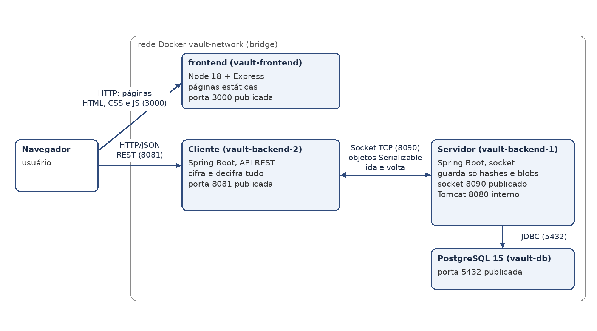
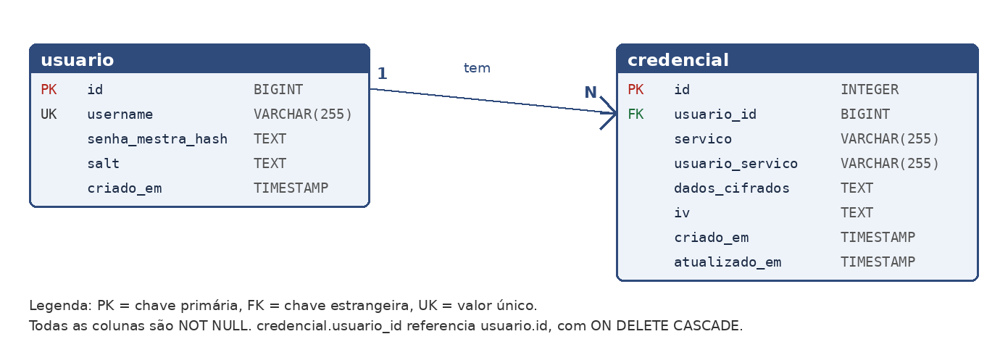
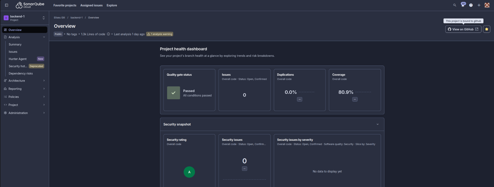
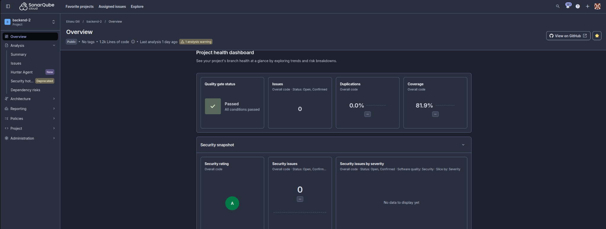
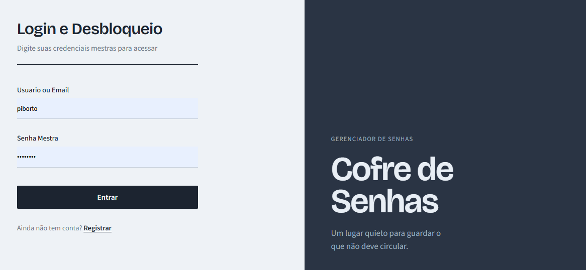
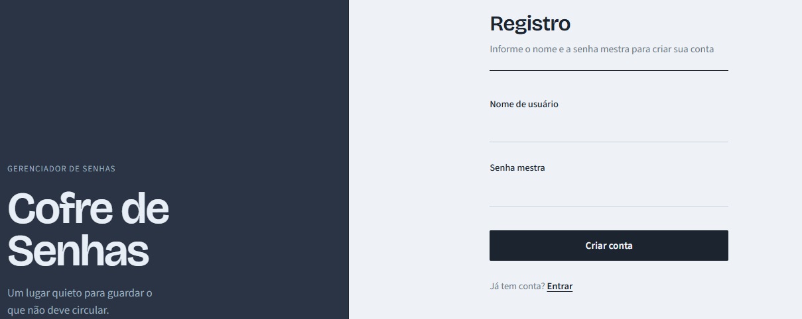
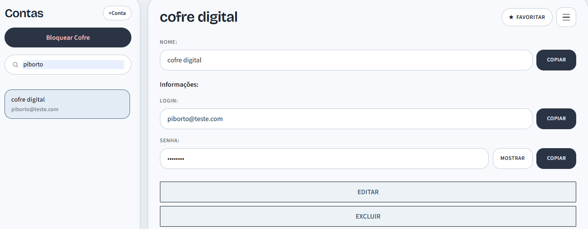
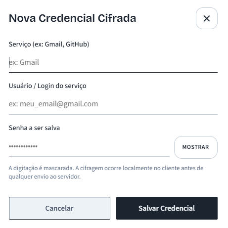
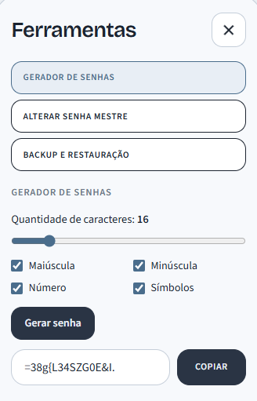
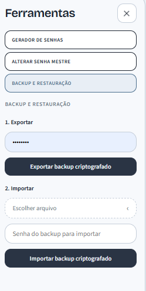

Cofre Digital de Senhas Criptografadas

Documento de Projeto

Projeto Integrador PI4 2026-2 · Grupo 06 · PUC-Campinas

Eliseu Pereira Gili - 25009281

Guilherme Heron da Silva - 25014708

Leonardo Maciel Ferreira de Moraes - 25013925

Pietra Façanha Bortolato - 25002436

## Sumário

- [1. Visão geral](#1-visão-geral)
- [2. Objetivos](#2-objetivos)
- [3. Requisitos](#3-requisitos)
    - [3.1 Requisitos funcionais](#31-requisitos-funcionais)
    - [3.2 Requisitos não funcionais](#32-requisitos-não-funcionais)
    - [3.3 Rastreabilidade](#33-rastreabilidade)
- [4. Arquitetura](#4-arquitetura)
    - [4.1 Visão](#41-visão)
    - [4.2 Implantação com Docker](#42-implantação-com-docker)
    - [4.3 Comunicação por socket](#43-comunicação-por-socket)
    - [4.4 Tecnologias](#44-tecnologias)
- [5. Banco de dados](#5-banco-de-dados)
- [6. Contratos e decisões](#6-contratos-e-decisões)
    - [6.1 Contratos (fichas CT)](#61-contratos-fichas-ct)
    - [6.2 Decisões (ADRs)](#62-decisões-adrs)
- [7. Testes](#7-testes)
    - [7.1 Estratégia](#71-estratégia)
    - [7.2 Testes automatizados](#72-testes-automatizados)
    - [7.3 Bateria funcional](#73-bateria-funcional)
    - [7.4 Casos de teste (amostra)](#74-casos-de-teste-amostra)
    - [7.5 Resumo da execução](#75-resumo-da-execução)
    - [7.6 Defeitos](#76-defeitos)
- [8. Principais telas](#8-principais-telas)
- [9. Como rodar](#9-como-rodar)
- [10. Conclusão](#10-conclusão)
- [11. Anexos](#11-anexos)

# 1. Visão geral

Responsável: Pietra

### Problema

Pessoas precisam de muitas senhas diferentes e costumam anotá-las em cadernos ou arquivos sem proteção. Quem lê essas anotações consegue acessar as contas. Gerenciadores prontos resolvem o problema, mas exigem confiança total no serviço que guarda as senhas. O Cofre Digital guarda as credenciais de forma que o servidor nunca tenha acesso ao conteúdo em texto claro.

### Público

Usuário final: cria uma conta com nome e senha mestra, guarda credenciais de serviços, gera senhas fortes e exporta ou restaura um backup cifrado.

Desenvolvedor que dará continuidade: precisa subir o sistema com um comando e entender as fronteiras de segurança, a partir deste documento e dos ADRs.

### Escopo

Os entregáveis E1 a E9 estão detalhados no capítulo 3. Em resumo: servidor com múltiplas conexões, cadastro, autenticação, salvar, consultar, editar e excluir credenciais, gerador de senhas, backup cifrado e restauração.

### Fora do escopo

Aplicativo móvel nativo.

Recuperação da senha mestra. Sem ela, os dados cifrados não podem ser recuperados.

Compartilhamento de senhas entre usuários.

Preenchimento automático em sites.

Autenticação por biometria.

Criptografia de arquivos gerais.

Internacionalização (o sistema é só em português).

# 2. Objetivos

Responsável: Guilherme

Objetivo geral: construir um sistema cliente-servidor de cofre de senhas que armazene credenciais de forma segura e gere senhas fortes no cliente, criptografando os dados antes de enviá-los, para que o servidor central não tenha acesso às informações em texto claro.

Objetivos específicos:

Realizar o cadastro e a autenticação do usuário com uma senha mestra, sem que ela saia do cliente (OE1).

Cadastrar, consultar, editar e excluir credenciais dentro do cofre cifrado (OE2).

Gerar senhas fortes automaticamente e permitir a exportação e a restauração de backups portáteis (OE3).

Critério de sucesso (da Entrega 1): em dezembro, o usuário faz login com sua senha mestra, cadastra uma credencial, usa o gerador, consulta os dados salvos e exporta um backup cifrado, sem que o servidor tenha acesso ao texto claro.

# 3. Requisitos

Responsável: Leonardo

## 3.1 Requisitos funcionais

A prioridade foi derivada do tamanho estimado na Entrega 1 (G = Alta, M = Média). A situação descreve o estado na entrega. Os testes finais de 23/11/2026 cobriram a API e a tela no navegador, e todos passaram.

| ID | Requisito | Feito quando (Entrega 1) | Prioridade | Situação | Fluxo / contratos |
|---|---|---|---|---|---|
| E1 | Servidor multiconexão | Dois usuários abrem o sistema ao mesmo tempo, mandam comandos e o servidor responde aos dois sem travar | Alta | Pronto na API. Teste automatizado com dois clientes simultâneos. | Fluxo E1; socket (ADR 0007) |
| E2 | Cadastro de usuário | Cria conta com nome de usuário e senha mestra, e recebe a confirmação | Média | Pronto na API | Fluxo E2; CT1, CT9 |
| E3 | Autenticação | Informa usuário e senha corretos e vê o menu; se errar, vê a mensagem de erro | Alta | Pronto na API, com bloqueio por tentativas | Fluxo E3; CT3 |
| E4 | Salvamento de credencial cifrada | Digita os dados de um serviço, o cliente cifra a senha e o servidor guarda sem conseguir ler | Alta | Pronto na API | Fluxo E4; CT2, CT10 |
| E5 | Consulta de credencial | Pede a senha de um serviço e a vê em texto claro na tela | Média | Pronto na API (listar e revelar) | Fluxo E5; CT4 |
| E6 | Edição e exclusão | Edita e exclui dados; após excluir, não consegue mais consultá-los | Média | Pronto na API e no front | Fluxo E6; CT5, CT6 |
| E7 | Gerador de senhas fortes | Escolhe as opções e recebe uma senha forte | Média | Pronto na API (GET /api/crypto/generate). A tela gera a senha no próprio navegador. | Fluxo E7 |
| E8 | Backup cifrado | Exporta um arquivo .vault cifrado e o identifica no disco | Alta | Pronto na API; o .vault é montado no Cliente | Fluxo E8; CT7; ADR 0006 |
| E9 | Restauração do backup | Importa um .vault com a senha mestra e as credenciais ficam disponíveis | Alta | Pronto na API; recifragem com a chave atual | Fluxo E9; CT8; ADR 0006 |

## 3.2 Requisitos não funcionais

| ID | Requisito | Como verificar | Situação |
|---|---|---|---|
| RNF-01 | O sistema sobe com um único comando (docker compose up), após criar o arquivo .env com as senhas | Subir a stack do zero e acessar http://localhost:3000 | Verificado. Ao subir, o servidor leva cerca de 30 segundos. |
| RNF-02 | Se um backend cai, o cliente informa a falha e se recupera sem reiniciar | Derrubar o servidor, tentar login (503 ERRO_CONEXAO), religar e logar de novo | Verificado na stack |
| RNF-03 | Reconexão do socket: o cliente reconecta sozinho quando o servidor volta | Mesmo teste do RNF-02 | Verificado na stack |
| RNF-04 | Desempenho: duas requisições de 2 s em paralelo terminam em menos de 3,5 s, sem bloqueio entre elas | Teste de concorrência automatizado | Verificado. Não há medição de latência em carga real. |
| RNF-05 | Segurança das senhas: a chave de cifragem e o token nunca saem do cliente; senhas são cifradas com AES-256-GCM e a chave vem de PBKDF2-HMAC-SHA256 com 120.000 iterações | Teste de unidade do cliente; inspeção das respostas da API (nenhuma contém chave ou token) | Verificado |
| RNF-06 | Limite de tentativas de login: 5 falhas por usuário ou 20 por IP, em 15 minutos | Teste de unidade e bateria funcional | Verificado |
| RNF-07 | Containers rodam sem privilégio de root | docker run ... id | Verificado no cliente e no front (uid não zero) |
| RNF-08 | Dados pessoais em logs: nome de usuário e IP são registrados; senhas, hashes, tokens e dados cifrados nunca | Testes de unidade que procuram segredos no log | Verificado. Retenção sem limite de tempo, por decisão do grupo; apagamento com script com confirmação. |

## 3.3 Rastreabilidade

| Requisito | Fluxo | Contratos | Testes |
|---|---|---|---|
| E1 | E1 | socket, Comunicado | SocketServidorTest (cadastro, login, CRUD, dois clientes, desligamento) |
| E2 | E2 | CT1, CT9 | SocketServidorTest, ClienteServiceTest, bateria funcional |
| E3 | E3 | CT3 | SocketServidorTest, ClienteServiceTest e bateria funcional |
| E4 | E4 | CT2, CT10 | SocketServidorTest, ClienteServiceTest, bateria funcional |
| E5 | E5 | CT4 | ClienteServiceTest (revelar), bateria funcional |
| E6 | E6 | CT5, CT6 | SocketServidorTest, bateria funcional; teste do id inválido (card 1393) |
| E7 | E7 | - | CryptoServiceTest, CryptoControllerTest, bateria funcional |
| E8 | E8 | CT7 | ClienteServiceTest (exportar sem texto claro), bateria funcional |
| E9 | E9 | CT8 | ClienteServiceTest (importar com senha errada não envia nada), bateria funcional |

# 4. Arquitetura

Responsável: Eliseu

## 4.1 Visão

O sistema roda em quatro contêineres, definidos no docker-compose.yml da raiz do projeto. O navegador carrega as páginas do frontend (porta 3000) e fala por HTTP/REST apenas com o Cliente (porta 8081). O Cliente cifra e decifra tudo e fala com o Servidor por socket TCP (porta 8090), por uma conexão persistente que atende um pedido por vez. O Servidor guarda no PostgreSQL apenas hashes, salts e dados já cifrados: a senha de cada credencial nunca chega a ele em texto claro.

Figura 4.1: diagrama de contêineres. Cada seta tem o que passa e o meio de comunicação. Os números entre parênteses são as portas publicadas no host.

## 4.2 Implantação com Docker

| Serviço (contêiner) | Imagem | Porta publicada (ports) | Porta só interna | Depende de |
|---|---|---|---|---|
| db (vault-db) | postgres:15 | 5432:5432 | não usa expose | nenhum. Healthcheck com pg_isready |
| backend-1 (vault-backend-1), Servidor | build do Dockerfile: eclipse-temurin:17-jre-alpine (build com maven:3.9.6) | 8090:8090 (socket) | Tomcat na 8080, não publicada | db, com condição service_healthy |
| backend-2 (vault-backend-2), Cliente | build do Dockerfile: eclipse-temurin:17-jre-alpine (build com maven:3.9.6) | 8081:8081 (API REST) | não usa expose | backend-1 (só ordem de início) |
| frontend (vault-frontend) | build do Dockerfile: node:18-slim, com Express 4 | 3000:3000 | não usa expose | backend-2 (só ordem de início) |

Todos os serviços estão na rede vault-network (bridge). Como nenhum serviço usa expose:, as portas internas só são alcançadas dentro dessa rede. O Cliente não precisa da porta 8090 publicada: ele usa o nome de serviço backend-1 dentro da rede. A publicação serve para ferramentas no host, como o DBeaver no banco. Os volumes nomeados são postgres_data (banco), logs_servidor e logs_cliente (logs). O script de criação do banco, em pi4-0101-g6-backend-1/database, roda na primeira subida do volume do banco.

Variáveis obrigatórias no arquivo .env: DB_PASSWORD e JWT_SECRET (com pelo menos 32 caracteres). Sem elas, o compose não sobe e informa qual falta. A variável BACKEND2_URL, definida no compose para o frontend, não tem efeito: o front não a lê. No navegador, a URL do Cliente é http://localhost:8081 por padrão, e pode ser trocada pela chave CLIENTE_URL no localStorage.

## 4.3 Comunicação por socket

Quem é servidor e quem é cliente. O Servidor (vault-backend-1) abre um ServerSocket na porta 8090, configurada em servidor.porta. A thread AceitadoraDeConexao aceita cada conexão, e cada uma é atendida por uma SupervisoraDeConexao. O Cliente (vault-backend-2) é o cliente: no primeiro pedido, conecta-se ao host backend-1 na porta 8090 e reutiliza essa conexão nos pedidos seguintes. Uma trava garante que só um pedido por vez use a conexão, e a thread LeitorDoServidor recebe as respostas.

Formato das mensagens. Cada mensagem é um objeto Java Serializable, enviado com ObjectOutputStream e lido com ObjectInputStream. Os pedidos estendem Comunicado, as respostas são da classe Resposta, e todas ficam no pacote cofre.protocolo, idêntico nos dois repositórios e conferido por um teste de sincronia. O Servidor só desserializa classes de uma lista de permissão: as do próprio protocolo, Long, Integer, String, Number, Object, ArrayList, HashMap e Map$Entry. A profundidade máxima é 6, e cada coleção ou array tem no máximo 2000 elementos. Uma classe fora da lista é recusada.

| Mensagem (Cliente para Servidor) | Resposta | Ficha de contrato |
|---|---|---|
| PedidoDeSalt(username) | salt do usuário; salt falso quando a conta não existe | CT3, fase 1 |
| PedidoDeLogin(username, hashLogin) | token e usuarioId, ou erro | CT3, fase 2 |
| PedidoDeCadastro(username, senhaMestraHash, salt) | usuarioId, ou erro | CT1 |
| PedidoDeListagem(token) | credenciais cifradas, ou erro | CT4 |
| PedidoDeCriacao(token, servico, usuarioServico, dadosCifrados, iv) | resposta com os dados, ou erro | CT2 |
| PedidoDeAtualizacao(token, credencialId, servico, usuarioServico, dadosCifrados, iv) | resposta com os dados, ou erro | CT5 |
| PedidoDeExclusao(token, credencialId) | resposta com os dados, ou erro | CT6 |
| PedidoDeExportacao(token) | credenciais cifradas, ou erro | CT7 |
| PedidoDeImportacao(token, lista de credenciais recifradas) | quantidade inserida, ou erro | CT8 |
| PedidoDeTrocaSenha(token, hashLoginAtual, novoSenhaMestraHash, novoSalt, credenciais recifradas) | nova senha mestra gravada e credenciais recifradas, ou erro | sem ficha |
| PedidoParaSair | nenhuma: o Servidor encerra a conexão | sem ficha |
| ComunicadoDeDesligamento (Servidor para todos os clientes) | enviado quando o comando desativar é usado no Servidor | sem ficha |

Falha de conexão: se o Servidor não responde em 15 segundos, ou se a conexão cai, o Cliente fecha o socket e responde ao navegador com HTTP 503 e o código ERRO_CONEXAO. O mesmo acontece se o Servidor está fora do ar na hora de conectar. No pedido seguinte, o Cliente abre uma conexão nova sozinho. No Servidor, a queda aparece no log como "Conexão encerrada com erro", e a supervisora daquela conexão termina sem afetar as demais. Erros de negócio, como senha incorreta ou bloqueio por excesso de tentativas, voltam como resposta normal, não como queda de conexão.

## 4.4 Tecnologias

| Camada | Tecnologia (versão) | Por que o grupo escolheu |
|---|---|---|
| Servidor | Java 17 (eclipse-temurin 17), Spring Boot 3.2.5, Spring Data JPA com Hibernate 6.4.4, driver JDBC do PostgreSQL, PostgreSQL 15, JJWT 0.11.5 | Linguagem e stack da disciplina (ADR 0001). Banco relacional para usuários e credenciais (ADR 0003). |
| Cliente | Java 17, Spring Boot 3.2.5, javax.crypto do JDK: PBKDF2-HmacSHA256 com 120.000 iterações, AES/GCM com chave de 256 bits | Mesma stack do Servidor. A criptografia fica no Cliente, e o Servidor só guarda dados cifrados (ADR 0002). |
| Front | HTML, CSS e JavaScript puro; Node 18 (imagem node:18-slim) com Express 4.21 para servir os arquivos | Interface simples, sem framework. O front não faz criptografia: ela fica no Cliente (ADR 0002). |
| Testes | JUnit 5 (spring-boot-starter-test 3.2.5), JaCoCo 0.8.12; no Cliente, servidor falso com socket real (ServidorFalso); no front, Jest 29.7 e Supertest 7 | Testes sem depender de serviços externos. A cobertura é medida no CI. |
| Qualidade e CI | SonarCloud com o scanner Maven 4.0.0.4121 (JDK 21); GitHub Actions com setup-java 17 para o build | Análise a cada pull request. O build roda com Java 17, a mesma versão do contêiner. |
| Infraestrutura | Docker, Docker Compose v2, rede bridge e volumes nomeados | Tudo roda em contêiner (ADR 0004). Um único comando sobe o sistema. |

# 5. Banco de dados

Responsável: Pietra

Figura 5.1: diagrama entidade-relacionamento do banco vault_db. A cardinalidade 1:N está marcada com "1" no usuário e "N" na credencial.

usuario: guarda o nome de usuário, o hash de autenticação e o salt. Não guarda a senha mestra nem a chave de cifragem.

credencial: guarda o serviço, o login do serviço e a senha já cifrada, com o seu IV. Nunca guarda texto claro.

Relação 1:N: um usuário tem várias credenciais, e apagar o usuário apaga as credenciais dele (ON DELETE CASCADE). O detalhe campo a campo está nas fichas CT9 (usuario) e CT10 (credencial), no capítulo 6.

# 6. Contratos e decisões

Responsável: Leonardo

## 6.1 Contratos (fichas CT)

As fichas estão em docs/contratos/ do repositório pi4-0101-g6-backend-1. CT1 a CT8 descrevem mensagens do socket, que substituíram as rotas REST; CT9 e CT10 descrevem as tabelas do banco.

| CT | Nome | Fronteira | Mensagem (socket) | Ficha no repositório |
|---|---|---|---|---|
| CT1 | cadastrarUsuario | Socket TCP | PedidoDeCadastro | CT1-cadastrarUsuario.md |
| CT2 | salvarCredencial | Socket TCP | PedidoDeCriacao | CT2-salvarCredencial.md |
| CT3 | autenticarUsuario | Socket TCP | PedidoDeSalt e PedidoDeLogin | CT3-autenticarUsuario.md |
| CT4 | listarCredenciais | Socket TCP | PedidoDeListagem | CT4-listarCredenciais.md |
| CT5 | editarCredencial | Socket TCP | PedidoDeAtualizacao | CT5-editarCredencial.md |
| CT6 | excluirCredencial | Socket TCP | PedidoDeExclusao | CT6-excluirCredencial.md |
| CT7 | exportarBackup | Socket TCP | PedidoDeExportacao | CT7-exportarBackup.md |
| CT8 | importarBackup | Socket TCP | PedidoDeImportacao | CT8-importarBackup.md |
| CT9 | Tabela usuario | Banco | tabela usuario | CT9-Tabela usuario.md |
| CT10 | Tabela credencial | Banco | tabela credencial | CT10-Tabela credencial.md |

## 6.2 Decisões (ADRs)

Os ADRs estão em docs/adr/ do repositório pi4-2026-2-0101-grupo06.

| ADR | Título | Status | Arquivo no repositório |
|---|---|---|---|
| 0001 | Usar Java como linguagem principal | Aceito | 0001-usar-java-como-linguagem.md |
| 0002 | Realizar a criptografia no cliente (zero-knowledge) | Aceito | 0002-realizar-criptografia-no-cliente.md |
| 0003 | Adotar PostgreSQL como banco do servidor | Aceito | 0003-adotar-postgresql-como-banco-do-servidor.md |
| 0004 | Usar Docker em todas as partes do sistema | Aceito | 0004-usar-docker-em-todas-as-partes-do-sistema.md |
| 0005 | Especificação do login e derivação de chaves (zero-trust) | Aceito | 0005-especificacao-login-e-derivacao-chaves-zero-trust.md |
| 0006 | Especificação do backup cifrado (.vault) e recifragem | Aceito | 0006-especificacao-backup-cifrado-e-recifragem-zero-trust.md |
| 0007 | Comunicação cliente-servidor por socket TCP com threads | Aceito | 0007-comunicacao-cliente-servidor-por-socket.md |
| 0008 | Restringir a desserialização no socket a uma lista exata de classes | Aceito | 0008-desserializacao-restrita-no-socket.md |

# 7. Testes

Responsável: Eliseu

## 7.1 Estratégia

Há três níveis de teste. Os testes de unidade e de integração rodam a cada push, com JUnit no Servidor e no Cliente e com Jest no front, pelo GitHub Actions. Um servidor falso com socket real testa o Cliente sem depender do Servidor de verdade. A análise estática roda no SonarQube Cloud. Por fim, uma bateria funcional de 48 casos foi executada contra a stack completa, com docker compose, pela API do Cliente. Os testes finais completos foram executados em 23/11/2026: as suítes automatizadas, a bateria funcional e o teste pela tela do navegador. Todos passaram.

## 7.2 Testes automatizados

| Repositório | Testes | Cobertura de linhas | CI na main | SonarQube Cloud |
|---|---|---|---|---|
| backend-1 (Servidor) | 40 testes, todos passando | 86,1% | Verde | Quality gate OK. Sem issues abertas. Duplicação 0%. Cobertura no Sonar: 80,9% |
| backend-2 (Cliente) | 44 testes, todos passando | 85,6% | Verde | Quality gate OK. Sem issues abertas. Duplicação 0%. Cobertura no Sonar: 81,9% |

O SonarQube calcula a cobertura de outra forma, por isso o número do painel é menor que o do JaCoCo. A análise estática usa a organização egili no SonarQube Cloud. Ela roda no CI a cada push e em cada pull request, depois do build com JaCoCo. Os painéis são https://sonarcloud.io/dashboard?id=egili_pi4-0101-g6-backend-1 (Servidor) e https://sonarcloud.io/dashboard?id=egili_pi4-0101-g6-backend-2 (Cliente).

Figura 7.1: painel do SonarQube do Servidor em 23/11/2026, com o quality gate aprovado e nenhuma issue aberta.

Figura 7.2: painel do SonarQube do Cliente em 23/11/2026, com o quality gate aprovado e nenhuma issue aberta.

## 7.3 Bateria funcional

A bateria tem 48 casos. Foi executada em 16/11/2026, contra a stack completa com docker compose, pela API do Cliente. Na primeira execução, 45 passaram e 3 falharam. Duas falhas eram o mesmo defeito (id não numérico em editar e excluir devolvia 500), corrigido no card 1393. A terceira era erro do próprio script de teste, que procurava um padrão curto em texto cifrado. Em 23/11/2026, sobre o estado final da main, a bateria foi executada novamente, e os 48 casos passaram.

## 7.4 Casos de teste (amostra)

| ID | Verifica | Passos | Esperado | Obtido | Situação |
|---|---|---|---|---|---|
| TE-01 | Cadastro duplicado (E2) | Cadastrar o mesmo nome duas vezes | 409 USUARIO_JA_EXISTE | 409 USUARIO_JA_EXISTE | Passou |
| TE-02 | Login com senha errada (E3) | Logar com senha incorreta | 401 SENHA_INCORRETA | 401 SENHA_INCORRETA | Passou |
| TE-03 | Bloqueio após 5 falhas (RNF-06) | Cinco senhas erradas seguidas; depois, a senha certa | 429 MUITAS_TENTATIVAS | 429 | Passou |
| TE-04 | Senha com acento, emoji e aspas (E4, E5) | Salvar e revelar | Mesma senha | Mesma senha | Passou |
| TE-05 | Senha de 3000 caracteres (E4, E5) | Salvar e revelar | Mesma senha | Mesma senha | Passou |
| TE-06 | Usuário B não acessa credencial de A (E6) | Revelar, editar e excluir a credencial de A logado como B | 404 ou 403 | 404 ou 403 | Passou |
| TE-07 | Editar com id não numérico (E6) | PUT /api/credenciais/abc | 400 DADOS_INVALIDOS | 500 antes da correção; 400 depois | Corrigido (PR #26 do Cliente, mergeado) |
| TE-08 | Exportar sem credenciais (E8) | Exportar com conta vazia | BACKUP_VAZIO | BACKUP_VAZIO | Passou |
| TE-09 | Importar com senha errada (E9) | Importar o .vault com outra senha | 401 SENHA_INCORRETA | 401 SENHA_INCORRETA | Passou |
| TE-10 | Vault adulterado (E9) | Alterar o corpo do .vault | Recusado | 401 | Passou |
| TE-11 | Queda do servidor (RNF-02) | Parar o backend-1 e logar; religar e logar | 503 e depois 200 | 503 e depois 200 | Passou |
| TE-12 | Dois clientes em paralelo (E1) | 40 pedidos por cliente, ao mesmo tempo | Sem falha | Sem falha | Passou |
| TE-13 | Comando desativar (E1) | Digitar desativar no terminal do servidor | Clientes avisados; servidor sai com código 0 | Como esperado | Passou (pelo pseudo-terminal) |
| TE-14 | Tela no navegador (todos os E) | Fluxo completo pela interface | Fluxo completo sem erro | Fluxo completo sem erro | Passou (23/11/2026) |

## 7.5 Resumo da execução

Primeira execução da bateria funcional (16/11/2026): 48 casos, 45 passaram e 3 falharam. As falhas foram corrigidas, e o caso de id inválido passou. Execução final (23/11/2026, sobre a main): os 48 casos passaram, incluindo o TE-14, o teste pela tela do navegador. As suítes automatizadas também passaram: 40 testes no Servidor, 44 no Cliente e 17 no front.

## 7.6 Defeitos

| Defeito | Severidade | Situação | Card |
|---|---|---|---|
| Id não numérico em editar e excluir devolvia 500 | Média | Corrigido. PR #26 do Cliente, mergeado | 1393 |
| atualizado_em nunca era gravado; Hibernate alterava o tipo de usuario.id ao subir; índice duplicado | Média | Corrigido. PR #38 do Servidor, mergeado | 1392 |
| Banner "Sem resposta do Back-end 1" com o sistema no ar: a checagem usava localhost:8080, que não existe. Bloqueava cadastro e login pela tela | Alta | Corrigido. PR #27 do front, mergeado | 1473 |
| A senha da credencial aparecia aberta ao abrir a credencial | Média | Corrigido. PR #30 do front, mergeado | 1478 |
| Botão +Pasta sem função (mostrava um alerta) | Baixa | Corrigido. Botão removido. PR #28 do front, mergeado | 1476 |
| Ordem confusa dos botões de backup, e a exportação lia o campo de importação | Baixa | Corrigido. PR #29 do front, mergeado | 1477 |
| Alterar senha mestre não altera nada: o formulário só mostra um alerta | Alta | Corrigido. A troca recifra as credenciais numa transação. PRs #47 (Servidor), #34 (Cliente) e #31 (front), mergeados | 1480 |
| Problemas do SonarQube: S2119, S6813, S8786 e log injection no Cliente; desserialização (S5135) e duplicação no Servidor | Média | Corrigido. Sem issues abertas em 22/11/2026 | 1433, 1434, 1435, 1439 |
| Favoritar não funcionava: ao clicar, nenhum item era favoritado (só mudava a cor do botão) | Baixa | Corrigido. Favoritos guardados na sessão, no topo da lista, com botão DESFAVORITAR. PR #32 do front, mergeado em 24/11/2026 | 1488 |

# 8. Principais telas

Responsável: Guilherme

O front tem três páginas: o login (index.html), o cadastro (registro.html) e o cofre (cofre.html). O cofre concentra a lista de credenciais e as ferramentas. A tabela resume o que cada tela faz e as limitações conhecidas.

| Tela | Arquivo | Atende | O que faz e situação |
|---|---|---|---|
| Login e desbloqueio | index.html | E3 | Entrada com usuário e senha mestra. Mostra o erro de conexão quando o Cliente não responde. |
| Cadastro | registro.html | E2 | Cria a conta com nome de usuário e senha mestra. |
| Lista e detalhe de credenciais | cofre.html | E4, E5 | Lista os serviços e permite buscar. Ao abrir uma credencial, a senha aparece oculta, com o botão MOSTRAR. O botão FAVORITAR marca a credencial, que passa para o topo da lista; a marcação vale durante a sessão do navegador. |
| Nova conta, editar e excluir | cofre.html (modais) | E4, E6 | Modal de +CONTA para salvar, e modais para editar e excluir a credencial. |
| Gerador de senhas | cofre.html (Ferramentas) | E7 | Escolhe o tamanho e os tipos de caracteres. A senha é gerada no próprio navegador. |
| Backup e restauração | cofre.html (Ferramentas) | E8, E9 | Seção 1: exportar, com senha do backup. Seção 2: importar um arquivo .vault, com a senha do backup. |
| Alterar senha mestre | cofre.html (Ferramentas) | não consta em E1 a E9 | Confere a senha atual e troca a senha mestra. As credenciais são recifradas com a nova chave numa só operação (card 1480). |

Figura 8.1: tela de login e desbloqueio. O usuário entra com a senha mestra, que o Cliente usa para derivar as chaves; o Servidor não a recebe.

Figura 8.2: tela de cadastro. A criação da conta gera o salt e o hash da senha mestra no Cliente.

Figura 8.3: cofre com a credencial aberta. A senha começa oculta, e o botão MOSTRAR a exibe sob demanda.

Figura 8.4: janela para salvar uma nova credencial. A senha é cifrada no Cliente antes de ser enviada.

Figura 8.5: gerador de senhas, que cria a senha no próprio navegador.

Figura 8.6: ferramenta de backup. A exportação gera um arquivo .vault cifrado com a senha do backup.

# 9. Como rodar

Responsável: Pietra

Este capítulo resume o README.md do repositório pi4-2026-2-0101-grupo06, que tem o passo a passo completo.

1. Clonar os quatro repositórios no mesmo diretório pai: pi4-2026-2-0101-grupo06, pi4-0101-g6-frontend, pi4-0101-g6-backend-1 e pi4-0101-g6-backend-2. O docker-compose.yml usa caminhos relativos a eles.

2. Entrar em pi4-2026-2-0101-grupo06, executar cp .env.example .env e preencher DB_PASSWORD e JWT_SECRET. O JWT_SECRET deve ter 32 caracteres ou mais; gere com openssl rand -base64 48.

3. Executar docker compose up --build -d e aguardar cerca de 30 segundos. O Servidor leva esse tempo para ficar pronto.

4. Conferir: docker compose ps deve mostrar os quatro serviços em Up, com o db como healthy. Em http://localhost:8081/status, a resposta deve ser {"status":"ok"}.

5. Abrir http://localhost:3000 no navegador.

6. Para encerrar, executar docker compose down. Para apagar também os logs, executar ./scripts/limpar-logs.sh.

As portas usadas são 3000 (front), 8081 (Cliente), 8090 (socket do Servidor) e 5432 (PostgreSQL).

# 10. Conclusão

Responsável: Eliseu

O grupo entregou um gerenciador de senhas em quatro contêineres. A criptografia acontece no Cliente, e o Servidor guarda apenas dados cifrados e hashes. A arquitetura mudou em relação à entrega 2: o navegador conversa só com o Cliente, por HTTP, e o Cliente conversa com o Servidor por socket TCP com threads, como a disciplina pediu. Essa mudança foi a mais trabalhosa do projeto, porque exigiu repensar a comunicação, o protocolo e os testes.

A bateria funcional e a análise estática encontraram defeitos reais, e foram corrigidos. Entre eles estão um bug de banco que impedia gravar a data de atualização, um id inválido que devolvia erro 500, a checagem de conexão que bloqueava cadastro e login pela tela, e problemas de segurança apontados pelo SonarQube, como a desserialização no socket. Hoje, os dois backends passam no quality gate, sem issues abertas, com cobertura de linhas acima de 85%. Os testes finais, executados em 23/11/2026, passaram.

# 11. Anexos

Repositórios e painéis que sustentam este documento. Os links de código apontam para a branch main.

• Repositório principal (compose, documentação e ADRs): github.com/egili/pi4-2026-2-0101-grupo06

• Front-end: github.com/egili/pi4-0101-g6-frontend

• Servidor (backend-1): github.com/egili/pi4-0101-g6-backend-1

• Cliente (backend-2): github.com/egili/pi4-0101-g6-backend-2

• Fichas de contrato (CT1 a CT10): github.com/egili/pi4-0101-g6-backend-1/tree/main/docs/contratos

• Decisões (ADRs 0001 a 0008): github.com/egili/pi4-2026-2-0101-grupo06/tree/main/docs/adr

• Quadro do OpenProject: srv1889234.hstgr.cloud/projects/pi-iv-0101-g6

• Painel SonarQube do Servidor: sonarcloud.io/dashboard?id=egili_pi4-0101-g6-backend-1

• Painel SonarQube do Cliente: sonarcloud.io/dashboard?id=egili_pi4-0101-g6-backend-2

• Execuções do CI na main: github.com/egili/pi4-0101-g6-backend-1/actions, github.com/egili/pi4-0101-g6-backend-2/actions e github.com/egili/pi4-0101-g6-frontend/actions

• Release v1.0:

pi4-0101-g6-backend-1: https://github.com/egili/pi4-0101-g6-backend-1/releases/tag/v1.0

pi4-0101-g6-backend-2: https://github.com/egili/pi4-0101-g6-backend-2/releases/tag/v1.0

pi4-0101-g6-frontend: https://github.com/egili/pi4-0101-g6-frontend/releases/tag/v1.0

pi4-2026-2-0101-grupo06: https://github.com/egili/pi4-2026-2-0101-grupo06/releases/tag/v1.0
